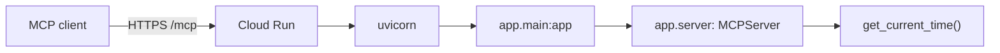

# Cloud Run MCP Server Template

A minimal [Model Context Protocol](https://modelcontextprotocol.io) server that deploys
to Google Cloud Run. It exposes **one tool**, `get_current_time()`, and nothing else.

Use it as a starting point: replace or add tools in
[app/server.py](./app/server.py), keep the HTTP wiring in
[app/main.py](./app/main.py), and deploy.

## What's in the box

```
app/
  server.py      the MCP server, its instructions, the get_current_time tool, /health
  main.py        the ASGI application (streamable HTTP, stateless) — uvicorn's target
Dockerfile       the Cloud Run image
requirements.txt runtime dependencies, pinned
deploy.sh        deploy with gcloud (macOS / Linux / WSL)
deploy.ps1       deploy with gcloud (Windows PowerShell)
```

No project IDs, keys, or API endpoints are baked in. The default service name is a
placeholder you can change. The only configuration Cloud Run needs is `PORT`,
which it injects itself.

## Requirements

- Python 3.10+ (the image uses 3.12)
- [gcloud CLI](https://cloud.google.com/sdk/docs/install), authenticated, with a
  Google Cloud project and billing enabled

## Run locally

```bash
python -m venv .venv

# macOS / Linux
source .venv/bin/activate
# Windows PowerShell
.venv\Scripts\Activate.ps1

pip install -r requirements.txt
uvicorn app.main:app --host 0.0.0.0 --port 8080
```

The server now listens on:

| Path      | Purpose                                |
| --------- | -------------------------------------- |
| `/mcp`    | the MCP endpoint clients connect to    |
| `/health` | liveness check                         |

Check it with curl:

```bash
curl http://localhost:8080/health
```

```json
{"status":"ok","service":"hsconnector-template","version":"0.1.0","mcp_endpoint":"/mcp"}
```

Call the tool over JSON-RPC. The server runs stateless, so a direct `tools/call`
works without a prior `initialize` (a normal MCP client still sends one):

```bash
curl -s http://localhost:8080/mcp \
  -H "Content-Type: application/json" \
  -H "Accept: application/json, text/event-stream" \
  -d '{
        "jsonrpc": "2.0",
        "id": 1,
        "method": "tools/call",
        "params": {"name": "get_current_time", "arguments": {}}
      }'
```

The result contains this server's current UTC time:

```json
{
  "jsonrpc": "2.0",
  "id": 1,
  "result": {
    "content": [{"type": "text", "text": "2026-10-23T15:31:35+00:00"}],
    "structuredContent": {"result": "2026-10-23T15:31:35+00:00"},
    "isError": false
  }
}
```

For an interactive client, run the MCP Inspector and point it at
`http://localhost:8080/mcp` using the **Streamable HTTP** transport:

```bash
npx @modelcontextprotocol/inspector
```

## Deploy to Cloud Run

The image is built in the cloud by `gcloud run deploy --source .`; Docker is not
needed locally.

```powershell
# Windows
./deploy.ps1 -ProjectId my-project
```

```bash
# macOS / Linux / WSL
bash deploy.sh my-project
```

Both scripts run the equivalent of:

```bash
gcloud run deploy hsconnector-template \
  --project my-project \
  --region us-central1 \
  --source . \
  --allow-unauthenticated \
  --port 8080 \
  --memory 512Mi \
  --cpu 1 \
  --timeout 300 \
  --min-instances 0 \
  --max-instances 10
```

When it finishes, the script prints the service URL. Your MCP endpoint is:

```
https://<service>-<hash>-<region>.a.run.app/mcp
```

Point any MCP client that supports Streamable HTTP at that URL. No headers or
credentials are needed by this template.

## How it fits together



- **`app/server.py`** defines the `MCPServer`, the instructions a model receives
  at `initialize`, and the tool. `@server.tool(...)` is all that is needed to
  expose a function.
- **`app/main.py`** calls `server.streamable_http_app(...)` to build the ASGI app.
  It runs **stateless** (`stateless_http=True`) because Cloud Run may serve any
  request from any instance; no session is kept in memory.
- **`Dockerfile`** runs uvicorn on `$PORT` with `--proxy-headers`, because TLS
  terminates in front of the container.

## Add your own tool

Add a decorated function in [app/server.py](./app/server.py):

```python
@server.tool(
    name="add_numbers",
    title="Add two numbers",
    description="Return the sum of a and b.",
    annotations=ToolAnnotations(read_only_hint=True),
)
def add_numbers(a: float, b: float) -> float:
    """Return a + b."""
    return a + b
```

Parameter names and type hints become the tool's input schema automatically, and
the docstring becomes its description. Then update `INSTRUCTIONS` so a model knows
when to call it, and redeploy.

Guidelines for tools that go beyond a template:

- Keep tools **stateless** where possible. Cloud Run can run several instances and
  can stop an idle one at any time.
- Do not write files and return paths. The filesystem is ephemeral; return the
  data (text, base64, a URL) in the tool result instead.
- Read secrets from environment variables or Secret Manager, never from source.
  Add them with `gcloud run deploy --set-env-vars` / `--set-secrets`, and keep a
  matching `.env.example` in the repo rather than a real `.env`.
- Long tools must finish inside the Cloud Run request timeout (`--timeout`, max
  60 minutes). For anything longer, return a job id and add a status tool.

## Security

`--allow-unauthenticated` is required for MCP clients, which cannot present a
Google identity token. **The URL is therefore public to anyone who knows it.**

This template exposes only a clock, so that is harmless. If you add a tool that
touches private data, spends money, or changes anything, put authentication in
front of `/mcp` first — for example a shared key checked in a Starlette middleware
before the MCP app sees the request. Do not rely on the URL being hard to guess.

## Logs and cleanup

```bash
gcloud run services logs read hsconnector-template --region us-central1 --limit 50
```

Delete everything when you are done:

```bash
gcloud run services delete hsconnector-template --region us-central1
```
