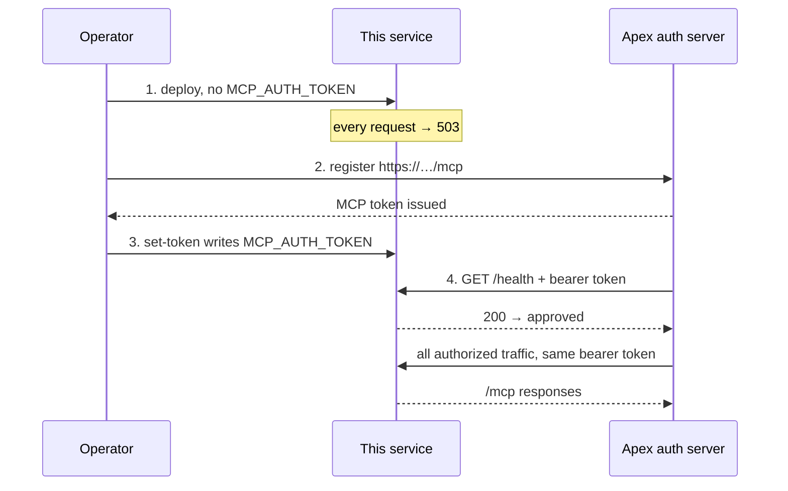
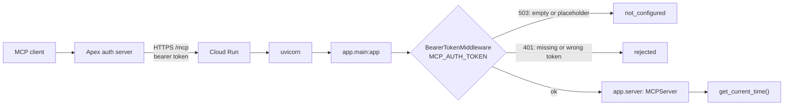

# Cloud Run MCP Server Template

A minimal [Model Context Protocol](https://modelcontextprotocol.io) server that deploys
to Google Cloud Run and is authorized by an apex auth server. It exposes **one tool**,
`get_current_time()`, and nothing else.

Use it as a starting point: replace or add tools in
[app/server.py](./app/server.py), keep the HTTP wiring in
[app/main.py](./app/main.py), and deploy.

## What's in the box

```
app/
  server.py        the MCP server, its instructions, the get_current_time tool, /health
  main.py          the ASGI application (streamable HTTP, stateless) + the bearer-token gate
Dockerfile         the Cloud Run image
requirements.txt   runtime dependencies, pinned
deploy.sh          deploy with gcloud, placeholder token (macOS / Linux / WSL)
deploy.ps1         deploy with gcloud, placeholder token (Windows PowerShell)
set-token.sh       write the issued MCP token into the service (macOS / Linux / WSL)
set-token.ps1      write the issued MCP token into the service (Windows PowerShell)
.env.example       local settings, no real values
```

No project IDs, keys, or API endpoints are baked in. The default service name is a
placeholder you can change. The only configuration Cloud Run injects itself is `PORT`.

## How a deployment gets authorized

The service has no real token when it is first deployed — the token does not exist
yet. The flow is:

1. **Deploy with a placeholder token.** `deploy.ps1` / `deploy.sh` write
   `MCP_AUTH_TOKEN=replace-with-issued-token`. The variable is always populated: a
   revision that omitted it entirely would make "never deployed" and "cleared"
   indistinguishable, and the step-3 update would have to guess. The placeholder is
   public, so it is not a credential — `app/main.py` treats it exactly like an empty
   value, and every request answers `503`: deployed, not yet authorized.
2. **Register the deployed URL.** Give the auth server
   `https://<service>-<hash>-<region>.a.run.app/mcp`. It issues the MCP token for that
   URL.
3. **Set the token.** `set-token.ps1` / `set-token.sh` replace the placeholder with the
   issued token and release a new revision.
4. **Approve.** Have the auth server `GET` the service URL with that token. A `200`
   approves the deployment; a `401` means the auth server holds a different token than
   the one set in step 3. Either URL works as the probe — `/health`, or the registered
   `/mcp` URL itself, which answers a `GET` with the same JSON instead of holding the
   connection open as an event stream.



From then on the auth server sends **all** authorized traffic through itself, and
every such request carries `Authorization: Bearer <token>`. The service accepts
nothing else.

## Requirements

- Python 3.10+ (the image uses 3.12)
- [gcloud CLI](https://cloud.google.com/sdk/docs/install), authenticated, with a
  Google Cloud project and billing enabled

## Run locally

```bash
python -m venv .venv

# macOS / Linux
source .venv/bin/activate
# Windows PowerShell
.venv\Scripts\Activate.ps1

pip install -r requirements.txt

# The gate is always on, so a local run needs a token too. Any value works here;
# locally it only has to match the token you pass to curl / the Inspector.
# PowerShell
$env:MCP_AUTH_TOKEN = "mcp_local_test_token"
# bash
export MCP_AUTH_TOKEN=mcp_local_test_token

uvicorn app.main:app --host 0.0.0.0 --port 8080
```

The server now listens on:

| Path      | Purpose                                          |
| --------- | ------------------------------------------------ |
| `/mcp`    | the MCP endpoint clients connect to              |
| `/health` | readiness/approval check, token required         |

Start it without `MCP_AUTH_TOKEN` (or with the deploy placeholder in it) and every
request answers `503 not_configured` — that is the same state a freshly deployed,
not-yet-authorized service is in.

Call the tool over JSON-RPC. The server runs stateless, so a direct `tools/call`
works without a prior `initialize` (a normal MCP client still sends one):

```bash
curl -s http://localhost:8080/mcp \
  -H "Content-Type: application/json" \
  -H "Accept: application/json, text/event-stream" \
  -H "Authorization: Bearer $MCP_AUTH_TOKEN" \
  -d '{
        "jsonrpc": "2.0",
        "id": 1,
        "method": "tools/call",
        "params": {"name": "get_current_time", "arguments": {}}
      }'
```

The result contains this server's current UTC time:

```json
{
  "jsonrpc": "2.0",
  "id": 1,
  "result": {
    "content": [{"type": "text", "text": "2026-10-23T15:31:35+00:00"}],
    "structuredContent": {"result": "2026-10-23T15:31:35+00:00"},
    "isError": false
  }
}
```

`/health` is the readiness check, and it needs the token as well:

```bash
curl -s http://localhost:8080/health -H "Authorization: Bearer $MCP_AUTH_TOKEN"
```

```json
{"status":"ok","service":"hsconnector-template","version":"0.1.0","mcp_endpoint":"/mcp","auth":"bearer"}
```

For an interactive client, run the MCP Inspector and point it at
`http://localhost:8080/mcp` using the **Streamable HTTP** transport, with an
`Authorization: Bearer <token>` header:

```bash
npx @modelcontextprotocol/inspector
```

## Authentication

The check is **always on**. [app/main.py](./app/main.py) wraps the MCP application in
`BearerTokenMiddleware`, which sees every HTTP request before the MCP transport does.

| `MCP_AUTH_TOKEN`                        | Behaviour                                          |
| --------------------------------------- | -------------------------------------------------- |
| empty                                   | every request → `503 not_configured`                |
| `replace-with-issued-token` (deploy)    | every request → `503 not_configured`                |
| the token the auth server issued        | every request must carry it, or `401`               |

The first two rows are the same state: no real token yet. The placeholder exists only so
the variable is populated on every revision — a revision that omits it makes "never set"
and "cleared" indistinguishable to the tooling that updates it later. It is in the
Dockerfile and both deploy scripts, so it is public by construction: nothing about it is
secret, and `Bearer replace-with-issued-token` is refused like any other wrong token.
`set-token.ps1` / `set-token.sh` refuse to write it for the same reason.

There is no mode in which the check is off, and no exempt path — not even `/health`.
That is deliberate: the approval `GET` in step 4 has to fail for a token this service
does not hold, and an exempt path would answer `200` to any caller. `/health` is
useful as the approval endpoint precisely because it answers only to a valid token.

The rules, in one place:

- **`Bearer` only.** The scheme is matched case-insensitively (RFC 9110). A bare token
  or a `Basic …` value is refused, because the auth server never sends one.
- **Verbatim comparison.** Everything after the scheme and one space is the token. The
  `mcp_` prefix is not special-cased and needs no escaping.
- **Constant-time.** Comparison uses `hmac.compare_digest`, so a wrong token cannot be
  recovered by timing the response, and a non-ASCII byte cannot raise.
- **Nothing secret is logged.** Startup logs eight hex characters of the token's
  SHA-256 (`MCP token ON (sha256 d0b24671)`), which is enough to tell two tokens apart
  in the Cloud Run console without exposing either.

A request with no token, or with the wrong one:

```json
{"error": "unauthorized", "detail": "Send the MCP token as `Authorization: Bearer <token>`."}
```

with `WWW-Authenticate: Bearer realm="mcp"`. Before the token is set:

```json
{"error": "not_configured", "detail": "This deployment has no MCP token yet. Register its URL with the auth server, set MCP_AUTH_TOKEN to the issued token, then retry."}
```

## Deploy to Cloud Run

The image is built in the cloud by `gcloud run deploy --source .`; Docker is not
needed locally. The scripts deploy with the **placeholder** token — step 1 above.

```powershell
# Windows
./deploy.ps1 -ProjectId my-project
```

```bash
# macOS / Linux / WSL
bash deploy.sh my-project
```

Each script runs the equivalent of:

```bash
gcloud run deploy hsconnector-template \
  --project my-project \
  --region us-central1 \
  --source . \
  --allow-unauthenticated \
  --port 8080 \
  --memory 512Mi \
  --cpu 1 \
  --timeout 300 \
  --min-instances 0 \
  --max-instances 10
```

When it finishes, the script prints the service URL, whether that revision carries the
placeholder or a real token, and the next step:

```
Deployed: https://<service>-<hash>-<region>.a.run.app/mcp
Health:   https://<service>-<hash>-<region>.a.run.app/health
Token:    placeholder - every request answers 503 until step 2 below.
```

The scripts write `MCP_AUTH_TOKEN=replace-with-issued-token` only when the service does
not already declare the variable, so a redeploy never overwrites a token that is already
there. They then read the variable back off the new revision and stop with an error if it
is absent, rather than leaving a revision in an ambiguous state.

`--allow-unauthenticated` is required for an MCP server: an MCP client cannot present a
Google identity token, so Cloud Run IAM would leave the service unreachable. It does
not make the endpoint usable — the MCP token is what guards it.

## Set the token, then approve

Once the auth server has issued the token for the registered URL:

```powershell
# Windows — the token stays out of shell history when it comes from the environment
$env:MCP_AUTH_TOKEN = "mcp_issued_by_the_auth_server"
./set-token.ps1 -ProjectId my-project
```

```bash
# macOS / Linux / WSL
MCP_AUTH_TOKEN=mcp_issued_by_the_auth_server bash set-token.sh my-project
```

The script:

1. writes `MCP_AUTH_TOKEN` with `gcloud run services update --update-env-vars`, so
   every other variable on the service is left alone;
2. reads the service URL back;
3. `GET`s `/health` with the token and expects `200` — the same check the auth server
   makes in step 4;
4. `GET`s `/health` without it and expects `401`, which proves the gate is on.

It retries for about a minute, because a new revision takes a few seconds to serve and
until then Cloud Run keeps routing to the old one (which still has the placeholder and
`503`). `-SkipVerify` (PowerShell) writes the variable and stops there; the bash script
always checks.

Then have the auth server do its `GET`. A `200` approves the server. A `401` means the
auth server holds a different token than the one you set — re-run the script with the
token it issued.

If the token must not sit in plain sight in the Cloud Run console, keep it in Secret
Manager and mount it as the same variable:

```bash
gcloud secrets create mcp-token --data-file=-
gcloud run services update hsconnector-template \
  --region us-central1 \
  --update-secrets MCP_AUTH_TOKEN=mcp-token:latest
```

The application only ever reads the environment variable, so nothing else changes.

## How it fits together



- **`app/server.py`** defines the `MCPServer`, the instructions a model receives at
  `initialize`, the tool, and `/health`. `@server.tool(...)` is all that is needed to
  expose a function.
- **`app/main.py`** calls `server.streamable_http_app(...)` to build the ASGI app, then
  wraps it in `BearerTokenMiddleware`. It runs **stateless** (`stateless_http=True`)
  because Cloud Run may serve any request from any instance; no session is kept in
  memory.
- **`Dockerfile`** runs uvicorn on `$PORT` with `--proxy-headers`, because TLS
  terminates in front of the container.

## Add your own tool

Add a decorated function in [app/server.py](./app/server.py):

```python
@server.tool(
    name="add_numbers",
    title="Add two numbers",
    description="Return the sum of a and b.",
    annotations=ToolAnnotations(read_only_hint=True),
)
def add_numbers(a: float, b: float) -> float:
    """Return a + b."""
    return a + b
```

Parameter names and type hints become the tool's input schema automatically, and the
docstring becomes its description. Then update `INSTRUCTIONS` so a model knows when to
call it, and redeploy.

Guidelines for tools that go beyond a template:

- Keep tools **stateless** where possible. Cloud Run can run several instances and can
  stop an idle one at any time.
- Do not write files and return paths. The filesystem is ephemeral; return the data
  (text, base64, a URL) in the tool result instead.
- Read credentials from environment variables or Secret Manager, never from source,
  and keep a matching `.env.example` in the repo rather than a real `.env`.
- If a tool call needs a credential from the caller, read it from the request rather
  than storing it server-side. `BearerTokenMiddleware` in `app/main.py` shows how to
  reach the request headers.
- Long tools must finish inside the Cloud Run request timeout (`--timeout`, max 60
  minutes). For anything longer, return a job id and add a status tool.

## Security

`--allow-unauthenticated` is required for MCP clients, which cannot present a Google
identity token. The URL is public to anyone who knows it; the MCP token is what
actually guards the service.

What that means in practice:

- **Nothing is served without the token.** An empty or placeholder `MCP_AUTH_TOKEN`
  refuses traffic rather than allowing it, so a fresh deploy is inert, not open. Do not
  add an exempt path to `BearerTokenMiddleware`, and do not add a way to treat the
  placeholder as valid — anyone can read it.
- **One shared token, not per-user auth.** Anyone holding it can call every tool.
  Because it is the auth server that issues it and sends it on every forwarded
  request, revocation happens on that side too: changing the token here (step 3) is
  what invalidates the old one, since only exactly one value is accepted.
- **Rotate with the same script.** `set-token.ps1` / `set-token.sh` use
  `--update-env-vars`, so rotation touches one variable and leaves the rest of the
  service alone.

## Logs and cleanup

```bash
gcloud run services logs read hsconnector-template --region us-central1 --limit 50
```

Each rejection is logged with the path and whether a token was missing or wrong —
never the value.

Delete everything when you are done:

```bash
gcloud run services delete hsconnector-template --region us-central1
```